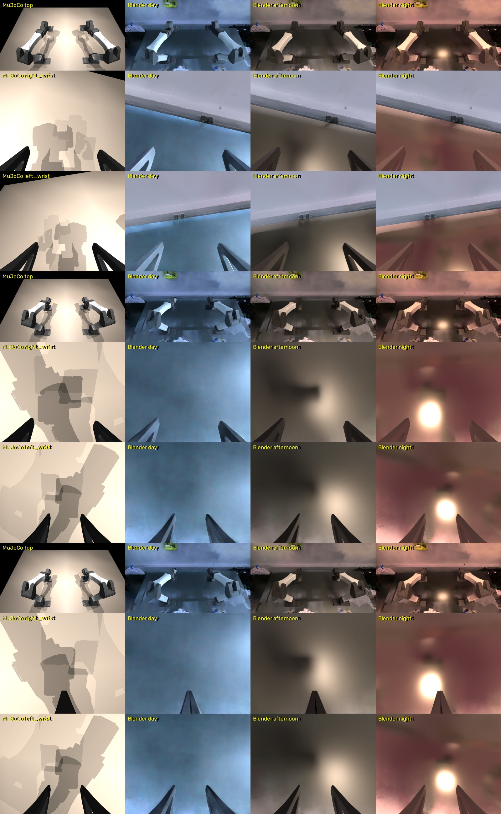

# yam-blender-scene-generation (`yam_r2s2r`)

Adapter between the I2RT YAM cell (driven through `~/agent_data_rl`) and the r2s2r appearance
pipeline (`uynitsuj/r2s2r`, branch `appearance/blender-trajectory-pipeline`): scan the workspace with
a YAM's wrist camera, turn the scan into the data r2s2r reconstructs from, and render robot
trajectories in Blender under randomized lighting / time of day.

Nothing in `~/r2s2r` or `~/agent_data_rl` is modified. r2s2r's code is imported from the local
snapshot `~/r2s2r_handoff/1_room_appearance/composite_handoff_v2` (override: `R2S2R_APPEARANCE_ROOT`);
the checked-out `yash-dev` branch of `~/r2s2r` does not contain the appearance package.



Scan data, datasets, trained room fields and renders live in `work/` on the rig PC (duchamp3) and are
not in git (several GB). `docs/` holds a few result images.

## Another YAM cell

The code is not tied to duchamp3; five things are, and each is a setting:

| What | Where it comes from | How to set it |
|---|---|---|
| Robot drivers and safety (i2rt, `safety.SafeArm`, `calib.Mover`, e-stop) | an `agent_data_rl` checkout on the cell's PC | `YAM_AGENT_REPO=/path/to/agent_data_rl` |
| CAN adapters and wrist-camera USB ports | that checkout's `scripts/real/rig.py` (`CAN_SERIAL`, `WRIST_CAM`) | edit `rig.py` for the cell, or `scan run --cam-device left /dev/v4l/by-path/...` for one run |
| Camera calibration: base-to-base pose, joint offsets, wrist intrinsics + mounts, top camera | a rig spec JSON from `agent_data_rl/scripts/real/calib.py` (`zed`, `find`, `collect`, `solve`) | `YAM_RIG_SPEC=/path/to/real_cameras_<cell>.json`, or `--spec` on each command |
| Table height in the right-base frame | measured: `check_poses` on a board on the table, or `table_z_from_points` printed by `reconstruct sfm` | `YAM_TABLE_Z=-0.02`, or `--table-z` |
| Top ZED serial (optional) | the camera's label / `ZED_Explorer` | `scan run --zed --zed-serial 12345678` |

Plus the render-side tools, the same on any machine: `R2S2R_APPEARANCE_ROOT` (the r2s2r appearance
snapshot, see above) and `R2S2R_BLENDER` (Blender 4.5.3).

Order on a new cell:

```bash
cd ~/yam_r2s2r
export YAM_AGENT_REPO=~/agent_data_rl YAM_RIG_SPEC=~/agent_data_rl/blind_insertion/configs/real_cameras_<cell>.json
A=$YAM_AGENT_REPO/.venv/bin/python; P=.venv/bin/python
# 0. calibrate the cell with agent_data_rl (writes the spec); check it before scanning:
(cd $YAM_AGENT_REPO && .venv/bin/python scripts/real/verify_cameras.py --out data/calib/verify_<cell>)
# 1. dry run: IK and safety checks for every planned view, no hardware
$A -m yam_r2s2r.scan plan --side both --out work/plan.json --table-views 40 --room-views 80 --seed 11
# 2. a first scan, then measure the table height and set YAM_TABLE_Z before building the environment
$A -m yam_r2s2r.scan run --side both --out work/sessions/<cond> --condition <cond> --table-views 40 --room-views 80 --seed 11 --zed
$P -m yam_r2s2r.build_dataset --session work/sessions/<cond> --out work/dataset
$P -m yam_r2s2r.reconstruct sfm --dataset work/dataset --out work/env/sfm   # prints table_z_from_points
```

Then follow "Recommended order for a new scan" below. Assumptions that hold for the I2RT YAM with
the stock wrist webcam and would need code changes otherwise: Menagerie `yam_linear_4310` kinematics
and fingers, world frame = right arm base, wrist images 1280x1024, two arms named `right` / `left`.

If a wrist camera drops off USB mid-scan (it happened on 2026-11-22), the arm returns to rest and
the views saved so far stay. Move the partial `<side>/` folder aside and rerun that side alone into
the same session (`scan run --side left --out <same session>`); the other side's entries are kept.

## Stages

| # | Command | Python | Reads | Writes |
|---|---|---|---|---|
| 1 | `yam_r2s2r.scan plan / run` | `~/agent_data_rl/.venv` | the arm + wrist camera | `sessions/<cond>/<side>/NNN.png + NNN.json {q}`, `session.json` |
| 2 | `yam_r2s2r.check_poses` | `.venv` | a session with a checkerboard | reprojection error of the pose chain |
| 3 | `yam_r2s2r.build_dataset` | `.venv` | sessions | r2s2r `benchmark.json`, undistorted images, robot/valid masks, `views/*.json` |
| 4 | `yam_r2s2r.reconstruct sfm` | `.venv` | dataset | r2s2r fixed-pose SfM (`points.ply`) + `points.npz` for splat training |
| 5 | `yam_r2s2r.reconstruct texture`, `yam_r2s2r.planes wall` | `.venv` | dataset | `env.json` + top-down table texture (relightable in Blender) |
| 6 | `yam_r2s2r.make_bundle` | `.venv` | a joint trajectory | `model.mjb`, `episode.npz`, per-camera `camera.json` + r2s2r Blender bundle |
| 7 | `yam_r2s2r.lighting` | any | - | `light_NNNN.json` recipes (hour, sun, sky, windows, lamps, camera) |
| 8 | `yam_r2s2r.collect` (runs `blender/render_dr.py`) | `.venv` + Blender 4.5.3 | bundles, recipes, env | `renders/<episode>/<recipe>/<camera>/*.png`, `render.json`, `index.jsonl` |

`.venv` here has pycolmap 4.2.1, mujoco 3.12, opencv, trimesh (`uv venv` + `uv pip install`).
World frame everywhere: the right arm base, metres; cameras OpenCV `world_from_camera`.

## Run it

```bash
cd ~/yam_r2s2r
A=~/agent_data_rl/.venv/bin/python     # rig python (i2rt, calib, safety)
P=.venv/bin/python

# 1. scan (MOVES THE ARM; see the checklist below). One session per lighting condition.
$A -m yam_r2s2r.scan plan --side both --out work/plan.json                 # no hardware: IK + safety checks only
$A -m yam_r2s2r.scan run  --side both --out work/sessions/day_1400 --condition day_1400

# 3-5. dataset, geometry, table
$P -m yam_r2s2r.build_dataset --session work/sessions/day_1400 --out work/dataset
$P -m yam_r2s2r.reconstruct sfm     --dataset work/dataset --out work/env/sfm
$P -m yam_r2s2r.reconstruct texture --dataset work/dataset --out work/env --sfm work/env/sfm

# 6. trajectories to render (a real run log, your own npz, or the built-in demo sweep)
$P -m yam_r2s2r.make_bundle --out work/episodes/ep0 --from-run ~/agent_data_rl/data/real_runs/<date>/<run>
$P -m yam_r2s2r.make_bundle --out work/episodes/demo --demo

# 7-8. lighting recipes and Blender data collection
$P -m yam_r2s2r.lighting --out work/lighting --n 64 --seed 0
$P -m yam_r2s2r.collect --episodes work/episodes/* --lighting work/lighting --env work/env/env.json \
    --out work/renders --per-episode 4 --samples 48 --device OPTIX
```

Scan checklist (from `agent_data_rl/scripts/real/README.md`): both bases clamped; `scripts/real/estop.py`
running in another terminal; the arm that is not scanning parked at the folded rest; the table arranged
as it should be reconstructed. `run` asks for `go` before it connects. Motion goes only through
`safety.SafeArm` / `calib.Mover` (table clearance, reach <= 0.42 m, <= 0.3 rad/s, tracking abort, return to
start). Exposure and white balance are locked for the scan and set back to auto afterwards.

## What exists in `work/` now

Three real scans, one environment per lighting condition (all on duchamp3):

| scan | time | views | dataset | environment | room field | held-out PSNR |
|---|---|---|---|---|---|---|
| `day_1645` | 2026-11-20 16:45 | 150 wrist | `dataset` | `env` | `room/splat` | 21.8 dB mean |
| `dusk_1716` | 2026-11-20 17:16 | 240 wrist + top | `dataset2` | `env2` | `room/splat2` | 23.9 dB mean, 7.8 worst |
| `midday_1215` | 2026-11-22 12:15 | 240 wrist + top | `dataset3` | `env3` | `room/splat3` | 24.5 dB mean, 9.6 worst |

`midday_1215`: poses refined from 1.65 to 0.66 px; table texture built with the off-colour filter
below (median 0.10 sRGB, a dark table); back wall 75% covered. `docs/midday_check.jpg` compares
Blender + the midday field (top row) with real frames (bottom row). Night and morning scans are not
taken yet.

First scan `sessions/day_1645` (2026-11-20, both arms, 75 views each: 40 table + 35 room, exposure and white
balance locked, none skipped):

- `dataset/` - 150 frames (130 train / 20 validation) in the r2s2r benchmark contract
- `env/sfm/` - r2s2r SfM: 130 views registered, 14,365 points, median reprojection 1.59 px; `points.npz`
- `env/env.json` - scanned table (`table_texture.png`, 86% covered, cropped at the wall) and the lab's
  back wall (`back_wall.png`: a vertical plane 0.557 m in front of the arms, 3.2 m wide, fitted to the points)
- `episodes/demo/` - 60-frame two-arm sweep, bundles for `right_wrist`, `left_wrist`, `top`
- `lighting/` - 32 random recipes; `lighting_tod/` - 6 recipes at fixed hours
- `renders/` - demo episode x 6 recipes x 3 cameras, `montage.jpg`, `index.jsonl`
- `*_calib/`, `renders_demo/`, `sessions/shakedown*` - earlier stand-in data and hardware tests

Walls are added per scan with
`$P -m yam_r2s2r.planes wall --dataset work/dataset --env work/env --region xmin ymin zmin xmax ymax zmax`
(RANSAC vertical plane on the SfM points in that box, then the images projected onto it).

Pose chain check on the calibration captures (`check_poses`): 3.7 px (right) / 3.9 px (left) mean
reprojection at 1280x1024 with both arms in one world frame; the 15 mm board squares come out at 14.95 mm.

## Room field (r2s2r splat)

```bash
A=.venv-appearance/bin/python      # r2s2r's pinned torch 2.14.1 + gsplat 1.5.3 (uv, requirements-cuda.txt)
$A -m yam_r2s2r.room train  --dataset work/dataset --points work/env/sfm/points.npz --out work/room/splat
$A -m yam_r2s2r.room render --weights work/room/splat/step15000.pt --episode work/episodes/demo --out work/room/renders/demo
$P -m yam_r2s2r.collect --episodes work/episodes/demo --lighting work/lighting_tod --env work/env/env.json --out work/renders_fg --transparent
$P -m yam_r2s2r.room composite --renders work/renders_fg --room work/room/renders --out work/renders_room
```

Two fields exist:

| | scan | views | poses | held-out PSNR (masked) | result |
|---|---|---|---|---|---|
| `work/room/splat` | `day_1645` | 150 wrist | FK | 21.8 dB mean, 11.6 worst (20 views) | floaters in the top camera and lab views |
| `work/room/splat2` | `dusk_1716` | 240 wrist + 1 top | bundle-adjusted | 23.9 dB mean, 7.8 worst (34 views) | clean table, wall and top camera; lab views soft |

The two validation sets differ, so the PSNR comparison is rough; the visual difference
(`work/renders_room/montage.jpg` vs `work/renders_room2/montage.jpg`) is the clearer evidence. One
held-out view of `splat2` fails outright (7.8 dB). People sit in several outward frames of both scans
and are not masked, so the lab beyond the table stays blurry.

Recommended order for a new scan:

```bash
$A -m yam_r2s2r.scan run --side both --out work/sessions/<cond> --condition <cond> --table-views 40 --room-views 80 --zed
$P -m yam_r2s2r.build_dataset --session work/sessions/<cond> --out work/dataset
$P -m yam_r2s2r.reconstruct refine --dataset work/dataset      # bundle-adjust poses (FK ones kept in benchmark_fk.json)
$P -m yam_r2s2r.reconstruct sfm --dataset work/dataset --out work/env/sfm
```

`refine` took mean reprojection from 1.65 to 0.65 px on `dusk_1716` (cameras moved a median 4 mm, 0.6 deg).
Bundle adjustment leaves scale free, so the result is fitted back to the FK camera centres with a
similarity (scale 0.979 on that scan, 0.999 on `day_1645`); the residual after the fit is what matters.
`--zed` saves one top-camera frame before the arms connect; `rest_q` in session.json records where each
arm really sits while the other scans, and the masks use it.

## MuJoCo simulation check

```bash
MUJOCO_GL=egl $P -m yam_r2s2r.sim --out work/episodes/sim0                      # physics + MuJoCo top / wrist renders
$P -m yam_r2s2r.make_bundle --out work/episodes/sim0 --from-npz work/episodes/sim0/sim.npz
$P -m yam_r2s2r.collect --episodes work/episodes/sim0 --lighting work/lighting_dan --env work/env2/env.json --out work/sim_val/fg --transparent
$A -m yam_r2s2r.room render --weights work/room/splat2/step20000.pt --episode work/episodes/sim0 --out work/room/renders2/sim0
$P -m yam_r2s2r.room composite --renders work/sim_val/fg --room work/room/renders2 --out work/sim_val/composite
# robot-only Blender pass per camera (render_dr.py --transparent --robot-only), then:
$P -m yam_r2s2r.validate_sim --episode work/episodes/sim0 --robot-only work/sim_val/robot_only --renders work/sim_val/composite --out work/sim_val
```

`sim0`: 7 s, 84 frames, both arms reach, close the grippers and retract under the Menagerie position
actuators (tracking error 0.10 rad max, 0.039 mean; lowest robot point 11.5 mm above the table).
MuJoCo robot silhouette vs Blender's, 21 frames per camera: IoU 0.997 (top), 0.998 (both wrists);
outlines within 0.17 px. MuJoCo's `principal_pixel` is the negative of (c - image centre) on both axes.
Results: `work/sim_val/side_by_side.mp4`, `stills.jpg`, `silhouette_overlay.jpg`, `validation.json`.

## Lighting model

Each recipe is sampled in plain Python and stored next to the images. Daylight is a physical sky plus a
sun lamp whose elevation/azimuth follow the solar position for the sampled hour, date and latitude; it
enters a box room only through randomized windows, so sun patches move with the hour. Ceiling panels
and a task lamp (2700-6500 K) are on or off; `--hdri-dir` adds HDRI skies. The camera has auto exposure
(a low-sample probe render sets the EV), an exposure bias and white balance. The scanned table is a
textured Cycles surface, so it relights with everything else.

## Limits (read before training on this)

- Only planar surfaces are reconstructed: the table and the back wall. The upper wall (the arm cannot
  look that high; 48% of the wall rectangle is covered, the rest is inpainted), the side of the room
  and everything behind the arms are still a generic box room. For those, train an r2s2r room field (`splat_cuda` / `nht` on `benchmark.json` + `points.npz`;
  needs the gsplat stack from `scripts/appearance/requirements-cuda.txt`, not installed here) and
  render with `--transparent` to composite over it. A room field is baked for the lighting it was
  captured in: scan once per time of day you want it to match.
- FK poses are good to ~4 px; the SfM stage keeps them fixed. For a sharp room field, refine poses first.
- Robot masks use the Menagerie `linear_4310` fingers; the real FlexPoint tips are larger, so the own
  gripper is masked with a wide margin. The arm that is not scanning is assumed parked at all-zeros.
- Table texture: pixels further than `--max-offset` (default 30/255) from the colour of the
  best-seen table area are replaced by that colour and blended in. Those are clutter behind the arm
  bases and wall reflections that the plane projection smears onto the table; without the filter the
  table renders whitish (`env` and `env2` were built before it and still have that).
- Table height is -0.023 m by default; SfM on the calibration data puts the surface at -0.026 m
  (`report.json: table_z_from_points`). Pass `--table-z` once a real scan confirms it.
- Robot colours are two flat materials (black / light); the yellow finger tips and the wrist webcam
  are not modelled. Wrist renders are undistorted pinhole at the calibrated K (640x512 by default);
  the policy's square crop is not applied.
- `make_bundle --from-run` assumes `ticks.npz: q` is measured (encoder) joints, order right, left.
